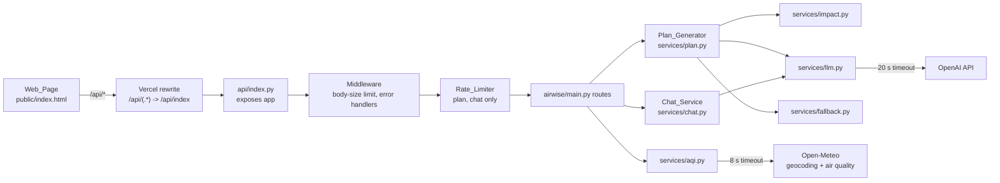
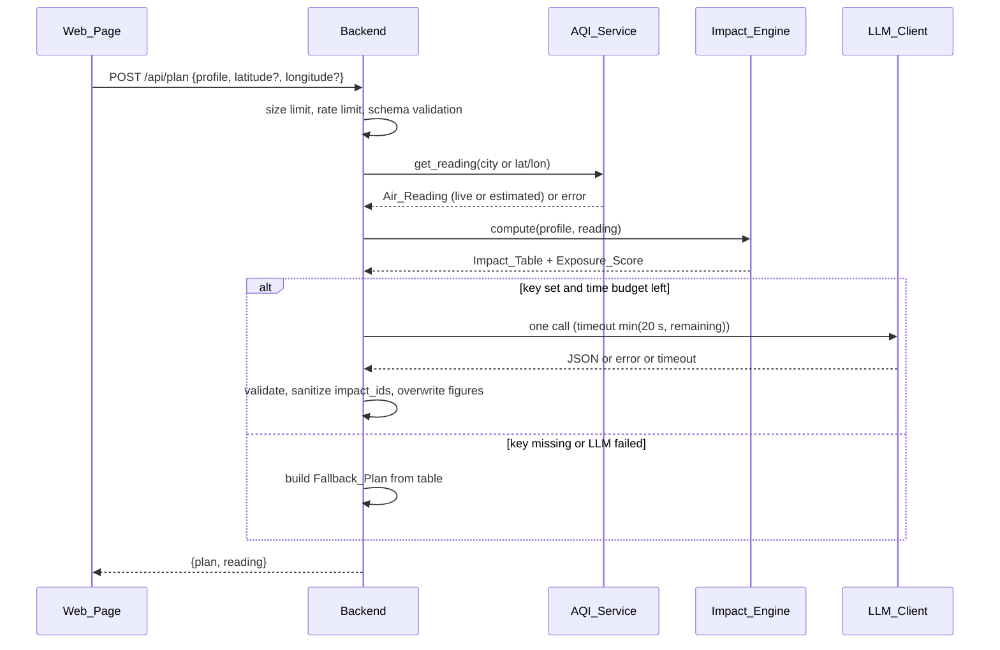

# Design Document

## Overview

AirWise is a FastAPI application deployed as one Vercel Python serverless function, plus one static HTML page with vanilla JavaScript. A request flows through four deterministic layers and one probabilistic layer:

1. **AQI_Service** geocodes a city (or accepts coordinates), reads PM2.5 and PM10 from Open-Meteo, and computes the India AQI, CPCB_Band, and indicative GRAP_Stage. On Air_Quality_API failure it returns a flagged Estimated_Reading.
2. **Impact_Engine** turns a Household_Profile and an Air_Reading into an Impact_Table and an Exposure_Score using a fixed rules table. No LLM is involved.
3. **Plan_Generator** makes at most one LLM call that writes routines and "why it matters" text. The LLM only references table rows by `impact_id`. The server then overwrites every figure from the table.
4. **Fallback_Plan builder** produces a schema-valid Plan from the same table when the LLM is unavailable, slow, or invalid.
5. **Chat_Service** answers follow-up questions statelessly from the Chat_Request contents.

The key design decision is the split between numbers and prose. Every figure shown to the user originates in `impact.py` or `aqi.py`. The LLM supplies wording only, and the server enforces that.

### Research summary

- **Open-Meteo Geocoding**: `GET https://geocoding-api.open-meteo.com/v1/search?name=<city>&count=1&language=en&format=json&countryCode=IN`. No key. Results are ranked, so `count=1` yields the top-ranked match, and `countryCode=IN` restricts the search to India. An unmatched name returns a response with no `results` key.
- **Open-Meteo Air Quality**: `GET https://air-quality-api.open-meteo.com/v1/air-quality?latitude=..&longitude=..&current=pm2_5,pm10`. No key. Values are ug/m3 and instantaneous. CPCB defines AQI on 24-hour averages, so the computed AQI is an approximation. The UI labels the reading "current", and the README disclaimer covers this.
- **CPCB India AQI**: The sub-index uses piecewise-linear interpolation, `I = (Ihi - Ilo) / (BPhi - BPlo) * (C - BPlo) + Ilo`, with the breakpoints in the table below. The AQI is the maximum sub-index.
- **OpenAI**: The Chat Completions API supports `response_format` of type `json_schema` with `strict: true` on `gpt-4o-mini`. Strict mode accepts only a subset of JSON Schema keywords, so the schema sent to the model carries types and required fields. Pydantic enforces lengths and counts after the response arrives. The SDK client is created with `max_retries=0` and a `timeout`.
- **Vercel Python**: A file at `api/index.py` that exposes an ASGI `app` is served as a function. `vercel.json` `rewrites` send `/api/(.*)` to `/api/index`, and FastAPI routes on the original path. `functions."api/index.py".maxDuration` and `includeFiles` are already set in the repository's `vercel.json` (30 s, `public/**`). Files in `public/` are served statically at `/` by Vercel. `includeFiles` also lets the function read `public/index.html` for local serving and as a fallback.

CPCB breakpoints (concentration ug/m3 to sub-index):

| Band | AQI range | PM2.5 | PM10 |
|---|---|---|---|
| Good | 0-50 | 0-30 | 0-50 |
| Satisfactory | 51-100 | 31-60 | 51-100 |
| Moderate | 101-200 | 61-90 | 101-250 |
| Poor | 201-300 | 91-120 | 251-350 |
| Very Poor | 301-400 | 121-250 | 351-430 |
| Severe | 401-500 | 251-380 | 431-510 |

Concentrations above the top of the last range yield 500 (cap). Concentrations that fall in the integer gap between two ranges (for example 30.5) are assigned to the next range and clamped to that range's low sub-index.

## Architecture



### Plan request sequence



### Design decisions

| Decision | Rationale |
|---|---|
| LLM output references `impact_id`; server fills figures | Satisfies 6.7 by construction. The LLM schema has no numeric fields for impact. |
| Impact_Engine is a data-driven rules list | Deterministic, easy to test, easy to extend. Rule order is fixed, so output order is fixed. |
| `1 - prod(1 - r_i)` for the Exposure_Score | Overlapping measures do not add linearly. The result never exceeds the sum, and a final `min(score, sum, 100)` guards against rounding. |
| Request deadline of 28 s with LLM timeout `min(20, remaining - 1)` | Worst case is 8 s geocoding + 8 s air quality + 20 s LLM = 36 s, which exceeds `maxDuration` 30 s. A request-level deadline keeps the response inside the limit. If less than 2 s remain, the LLM call is skipped and the Fallback_Plan is returned. This still satisfies "at most one call". In the normal case the LLM timeout is 20 s, at least 2 s below `maxDuration` (12.8). |
| Hard timeout via `asyncio.wait_for` around the SDK call, plus SDK `timeout` | Bounds total time even if the SDK timeout covers only part of the call. |
| Services take injected `httpx.AsyncClient` and an `LLMClient` protocol | Tests run with `httpx.MockTransport` and a fake LLM client, with no network. |
| In-memory fixed-window limiter with injectable clock | Matches the requirement and is deterministic in tests. It is per warm instance only, so it is best effort on serverless. Cold starts and parallel instances each hold their own counters. |
| Chat scope guard runs before the LLM | Diagnosis, medication, and official-GRAP-declaration requests (15.5) are declined deterministically with no LLM cost. |
| Chat LLM returns `{reply, on_topic, discusses_health}`; server applies the off-topic reply and the not-medical-advice note | Requirements 8.4 and 8.5 become server-enforced instead of prompt-dependent. |
| Geolocation users get a location label instead of a city name | The Household_Profile requires a city of 1-100 characters. The Web_Page fills the city field with `My location` when it is empty and coordinates are in use. |

## Components and Interfaces

### Repository layout

```
api/index.py                 # from airwise.main import app  (thin entrypoint)
airwise/
  __init__.py
  main.py                    # create_app(), routes, exception handlers, GET /
  config.py                  # constants and env reading
  models.py                  # all Pydantic models
  errors.py                  # AppError hierarchy
  middleware.py              # BodySizeLimitMiddleware, client_ip()
  ratelimit.py               # FixedWindowLimiter
  services/
    __init__.py
    aqi.py                   # geocode, fetch, compute AQI, band, GRAP, estimated reading
    impact.py                # Impact_Table rules, Exposure_Score
    llm.py                   # LLMClient protocol, OpenAIClient
    plan.py                  # Plan_Generator orchestration, sanitize, ensure_*
    fallback.py              # build_fallback_plan()
    chat.py                  # Chat_Service, scope guard
public/index.html
vercel.json
pyproject.toml
tests/
README.md
.env.example
```

### `config.py`

```python
GEOCODE_URL = "https://geocoding-api.open-meteo.com/v1/search"
AQ_URL = "https://air-quality-api.open-meteo.com/v1/air-quality"
OPEN_METEO_TIMEOUT_S = 8.0
LLM_TIMEOUT_S = 20.0
REQUEST_DEADLINE_S = 28.0      # below maxDuration (30)
LLM_MIN_BUDGET_S = 2.0         # skip the LLM call if less time remains
MAX_BODY_BYTES = 65_536
PLAN_LIMIT, CHAT_LIMIT, WINDOW_S = 10, 30, 60
ESTIMATED_PM25, ESTIMATED_PM10 = 150.0, 260.0   # typical winter values

def openai_api_key() -> str | None   # os.environ only; empty string -> None
def openai_model() -> str            # OPENAI_MODEL or "gpt-4o-mini" when unset or empty
```

Credentials are read only from `os.environ` at call time. Nothing reads them from request data.

### `services/aqi.py`

```python
def sub_index(conc: float, table: list[Breakpoint]) -> float
def compute_aqi(pm25: float | None, pm10: float | None) -> int      # max of available sub-indices, round, cap 500
def band_for(aqi: int) -> CPCBBand
def grap_for(aqi: int) -> GrapStage                                  # "none" when aqi <= 200

async def geocode(client: httpx.AsyncClient, city: str) -> Place     # raises CityNotFound | LookupUnavailable
async def fetch_pm(client, lat: float, lon: float) -> tuple[float | None, float | None]
async def get_reading(client, *, city: str | None, lat: float | None, lon: float | None) -> AirReading
def estimated_reading(name: str, lat: float | None, lon: float | None) -> AirReading
```

Behavior:

- The city is trimmed. If the trimmed length is not 1 to 100, the service raises `InvalidCity` before any HTTP call (1.9).
- `geocode` makes one request with timeout 8 s. No `results` key raises `CityNotFound` (1.8). A timeout, transport error, or non-2xx status raises `LookupUnavailable` (1.10). No Air_Quality_API call follows either error.
- `fetch_pm` makes one request with timeout 8 s and no retries (3.5). A non-numeric or missing value becomes `None`.
- `get_reading` catches every `fetch_pm` failure, including timeout, transport error, bad status, bad JSON, and both values `None`. It returns `estimated_reading(...)` with `source="estimated"` (3.1). If at least one value is present it returns `source="live"` and computes the AQI from the available values (3.2).
- Band and GRAP are pure functions of the integer AQI. They are used for both live and estimated readings.

### `services/impact.py`

```python
RULES: tuple[Rule, ...]            # fixed order
def compute_impact(profile: HouseholdProfile, reading: AirReading) -> ImpactResult   # rows + exposure_score
def combine(pcts: Iterable[float], cap: float = 100.0) -> float
```

`Rule` holds `id`, `applies(profile, reading) -> bool`, `pct(profile, reading) -> float`, `co2(profile, reading) -> float`, `action`, `basis`, `source_note`. `compute_impact` iterates `RULES` in order and keeps the applicable ones. It does not use randomness, clocks, or I/O.

`compute_impact` re-checks its inputs (profile and reading present, enumerations valid, numeric fields in range) and raises `InvalidInput(field)` on violation (5.11). Pydantic normally guarantees this earlier. The check protects direct callers.

Rules table (base figures are approximate and illustrative; basis and source text is shown in the UI):

| `id` | Applies when | Exposure reduction % | CO2 kg/day |
|---|---|---|---|
| `n95_mask` | AQI >= 101 | 15, plus 5 if kids, elderly, or respiratory | 0 |
| `purifier_or_diy` | no purifier (purifier or DIY Corsi-Rosenthal box) | 25 | 0 |
| `close_windows_peak` | habit is `open_often` or `sometimes`, and AQI >= 201 | 10 (`open_often`), 5 (`sometimes`) | 0 |
| `wet_cleaning` | AQI >= 101 | 5 | 0 |
| `clean_cooking` | cooking fuel is `biomass` | 30 | 1.5 |
| `biomass_heating_switch` | heating is `biomass_burning` | 25 | 2.0 |
| `transit_swap` | commute is `car` or `two_wheeler` | 8 (car), 6 (two_wheeler) | 3.0 (car), 1.2 (two_wheeler) |
| `carpool` | commute is `car` | 3 | 1.5 |
| `no_burning_pledge` | AQI >= 201, or cooking is `biomass`, or heating is `biomass_burning` | 5 | 0.5 |

This yields at most 9 rows (limit 15) and 0 rows for a clean-air profile with no triggering conditions (5.12). Rows for criteria 5.6 to 5.9 do not depend on AQI.

CO2 figures use stated assumptions in `basis` (for example, a car round trip of about 20 km at roughly 0.15 kg CO2 per km). Source notes describe the figures as illustrative estimates informed by public CPCB and WHO guidance. They do not cite a specific paper.

Exposure_Score:

```python
def combine(pcts, cap=100.0):
    remaining = 1.0
    for p in pcts:
        remaining *= (1.0 - p / 100.0)
    score = round(100.0 * (1.0 - remaining), 1)
    return max(0.0, min(score, sum(pcts), cap))
```

An empty input returns 0.0. A final `min(..., sum(pcts))` handles rounding, so the score never exceeds the sum (5.4).

### `services/llm.py`

```python
class LLMClient(Protocol):
    async def complete_json(self, *, system: str, user: str,
                            schema_name: str, schema: dict, timeout_s: float) -> dict: ...

class OpenAIClient:
    # AsyncOpenAI(api_key=<env>, timeout=timeout_s, max_retries=0)
    # chat.completions.create(model=openai_model(), messages=[system,user],
    #     response_format={"type": "json_schema",
    #                      "json_schema": {"name": schema_name, "strict": True, "schema": schema}},
    #     temperature=0.4)
    # wrapped in asyncio.wait_for(..., timeout_s); returns json.loads(content)

class LLMUnavailable(Exception)   # missing key, SDK error, timeout, unparsable JSON
```

`OpenAIClient` raises `LLMUnavailable` (without the key in the message) when the key is missing. In that case it performs no network call. Callers also check `openai_api_key()` first so a missing key is never counted as an LLM call.

Two hand-written JSON schemas are sent to the model, `PLAN_JSON_SCHEMA` and `CHAT_JSON_SCHEMA`. They declare types, `required`, and `additionalProperties: false`, but no length or count keywords, since strict mode does not accept them all. Pydantic validates lengths and counts afterwards.

Prompts:

- The system prompt fixes the role (India-focused air quality assistant), states that the output is general information and not medical advice, forbids invented numbers, and forbids diagnosis, treatment, and medication advice.
- The user prompt carries the profile, the reading, and the Impact_Table (ids, actions, figures) as JSON. For plans it tells the model to explain only those figures and to cite rows by `impact_id`.
- Untrusted text (the city name and chat history) is passed inside a JSON object, never concatenated into the instruction text.

### `services/plan.py` (Plan_Generator)

```python
async def generate_plan(profile, reading, *, llm: LLMClient, deadline: Deadline) -> Plan
```

Steps:

1. `impact = compute_impact(profile, reading)`.
2. If `openai_api_key()` is falsy or `deadline.remaining() < LLM_MIN_BUDGET_S`, return `build_fallback_plan(...)` with no LLM call (6.11, 7.1).
3. Make exactly one `llm.complete_json(...)` call with `timeout_s = min(LLM_TIMEOUT_S, deadline.remaining() - 1)`. There is no loop and no retry (6.1, 7.8, 12.6).
4. On `LLMUnavailable`, timeout, or any other exception, return the Fallback_Plan (7.2).
5. Validate the dict against `LLMPlan` (pydantic). On `ValidationError`, return the Fallback_Plan (7.3).
6. `sanitize`: set unknown `impact_id` values to `None`, drop duplicate bindings if needed, and attach `ImpactFigures` copied from the table to each item that has a valid `impact_id`. Any figure the model produced is not part of the schema and is discarded (6.7).
7. `ensure_vulnerable_note`: compute the groups present (kids, elderly, respiratory). If the note is missing or does not name each group, append a deterministic sentence that does, truncated to 500 characters (6.9).
8. `ensure_local_context`: derive the relevant local factors from the profile and reading, from the set {stubble burning, firecrackers, biomass cooking and heating, two-wheelers, metro use}. If no routine item carries a matching `context_factor` tag, append a deterministic routine item for the first relevant factor (6.8).
9. Assemble `Plan(fallback=False, estimated=reading.source == "estimated", impact_table=..., exposure_score=...)`.

The returned Plan always carries the Impact_Table, Exposure_Score, and estimated flag unchanged from step 1 (6.6, 3.4).

### `services/fallback.py`

`build_fallback_plan(profile, reading, impact) -> Plan` is pure and does not touch the LLM. It builds:

- Routine slots (morning, commute, midday, evening) from fixed templates keyed on CPCB_Band, `commute`, and the profile.
- One indoor hack per applicable indoor row (`purifier_or_diy`, `close_windows_peak`, `wet_cleaning`), and at least one generic hack when none apply.
- One swap per applicable swap row (`clean_cooking`, `biomass_heating_switch`, `transit_swap`, `carpool`, `no_burning_pledge`), and at least one generic swap when none apply.
- A vulnerable-members note naming each group present.
- A `why_it_matters` string for every item (1-300 characters) taken from the row `basis` or from the template.

The output is validated by `Plan.model_validate` in the builder itself, so it always satisfies the same schema as an LLM plan (7.6). It sets `fallback=True`.

### `services/chat.py`

```python
async def answer(req: ChatRequest, *, llm: LLMClient, deadline: Deadline) -> ChatReply
def out_of_scope(message: str) -> OutOfScope | None      # diagnosis, treatment, medication, official GRAP declaration
```

1. If `out_of_scope(...)` matches, return the decline message with no LLM call (15.5).
2. If the key is missing, return the failure message with no LLM call (8.10).
3. Make one LLM call (timeout 20 s, no retry) with the Plan, Air_Reading, profile, history, and message inside a JSON user payload.
4. On any failure or timeout, return `ChatReply(reply=CHAT_FAILURE_MESSAGE, failed=True)`. The message says the answer is unavailable and to try again later (8.10, 12.7).
5. Validate `{reply, on_topic, discusses_health}`. If `on_topic` is false, replace the reply with the fixed message of at most 2 sentences (8.4). If `discusses_health` is true, append `NOT_MEDICAL_ADVICE_NOTE` (8.5).
6. The reply is returned complete, with no streaming (8.11).

Numeric grounding (8.3) is enforced in the prompt, which supplies only the figures in the request. It is a best-effort control. The server cannot reliably verify free text, and the design does not claim to.

### `ratelimit.py`

```python
class FixedWindowLimiter:
    def __init__(self, limit: int, window_s: int = 60, clock=time.monotonic): ...
    def check(self, key: str) -> Decision   # Decision(allowed: bool, retry_after: int)
```

State is `dict[key, (window_start, count)]`. `key` is `f"{endpoint}:{client_ip}"`, so windows are independent per IP and endpoint. On each call:

- If `now - window_start >= window_s` (or no entry), start a new window with count 1 and allow.
- Else if `count < limit`, increment and allow.
- Else reject with `retry_after = max(1, min(window_s, ceil(window_start + window_s - now)))`.

Two limiter instances exist, one for plan (limit 10) and one for chat (limit 30). Rejected requests do not increment the count. Opportunistic cleanup removes expired entries when the dict exceeds 10,000 keys, which bounds memory.

The limiter runs as a FastAPI dependency on `/api/plan` and `/api/chat` and raises a 429 `AppError` with a `Retry-After` header. It runs before the handler body, so the LLM is never reached on a 429. It runs after body parsing, so a 413 or 422 request does not consume quota. This is a deliberate choice, since invalid requests never reach the LLM.

`client_ip(request)`: take the first comma-separated entry of `X-Forwarded-For`, strip whitespace, and accept it only if `ipaddress.ip_address(...)` parses. Otherwise use `request.client.host`, or `"unknown"` if that is absent (10.4, 10.5).

### `middleware.py`

`BodySizeLimitMiddleware` is a pure ASGI middleware. It rejects with 413 immediately when `Content-Length` exceeds 65,536. It also wraps `receive` and counts streamed bytes (for chunked bodies without `Content-Length`), and sends the 413 once the running total exceeds the limit, without handing the body to the app (9.2).

### `main.py`

| Method and path | Request | Success response | Errors |
|---|---|---|---|
| `GET /api/health` | none | `{"status": "ok"}` | none |
| `GET /api/aqi` | query `city` or `lat` and `lon` | `AirReading` | 422 invalid input, 404 `city_not_found`, 502 `lookup_unavailable` |
| `POST /api/plan` | `PlanRequest` | `PlanResponse` | 413, 422, 429, 404, 502 |
| `POST /api/chat` | `ChatRequest` | `ChatReply` | 413, 422, 429 |
| `GET /` | none | contents of `public/index.html` | none |

`GET /api/aqi` requires exactly one of `city` or both `lat` and `lon`. Supplying neither, or a mix, returns 422 with the field names.

All errors use one body shape: `{"error": {"code": str, "message": str, "fields": [str]}}`.

| Condition | Status | `code` |
|---|---|---|
| Schema or range violation | 422 | `validation_error` (`fields` lists each offending field path) |
| Body over 64 KB | 413 | `payload_too_large` |
| Rate limit exceeded | 429 | `rate_limited` (`Retry-After` header) |
| City not found | 404 | `city_not_found` |
| Geocoding down | 502 | `lookup_unavailable` |
| Unexpected exception | 500 | `server_error` (generic message) |

Exception handlers:

- `RequestValidationError` becomes the 422 shape. The handler builds `fields` from `loc` and does not echo submitted values, so a secret or oversized value cannot leak back.
- `AppError` subclasses map to their status and code.
- A catch-all `Exception` handler logs only the exception class name, returns the generic 500 body, and never includes a traceback, path, or environment value.

Dependencies (`httpx.AsyncClient`, `LLMClient`, limiter clocks) are provided through FastAPI `Depends` functions so tests use `app.dependency_overrides`.

### `public/index.html`

One file with inline `<style>` and `<script>`, no framework, no external script or stylesheet.

Layout, top to bottom:

1. Header with the AirWise name and a persistent disclaimer banner: general information, not medical advice (15.3). The banner is `position: sticky` at the top so it stays visible while the user reads advice (15.4).
2. Location block: city input, "Use my location" button, and a status area.
3. Household profile form with the fields in 4.1, a Generate button, and a Clear saved profile button.
4. Result area: AQI card (value, band, GRAP stage with the label "indicative, not an official declaration"), estimated-data notice or fallback notice (rendered above the plan, always visible), Exposure_Score, plan sections, Impact_Table, and the empty-table message.
5. Chat panel: 3 to 5 starter question buttons, history, input, and Send.

Behavior:

- All dynamic text is set through `textContent` or `document.createTextNode`. The page defines `el(tag, text, cls)` as its only element factory and contains no `innerHTML`, `outerHTML`, or `insertAdjacentHTML` assignment (11.3, 11.4).
- Geolocation calls `navigator.geolocation.getCurrentPosition` with `{timeout: 10000}` and a 10 s guard timer. On denial, unsupported, or timeout, it shows the "enter a city name" message, sends nothing, and keeps the city input enabled. On success it sends coordinates within 1 s. The loading indicator is shown and the button disabled until the lookup ends (2.1, 2.4, 2.6).
- localStorage access is wrapped in `try/catch`. On load, the saved JSON is parsed and checked by `isValidProfile()`, which mirrors the server rules. If it is invalid or unparsable, the entry is removed and an empty form is shown (4.9). The Profile is saved on generate and removed by Clear (4.4 to 4.7).
- Client state (`plan`, `reading`, `profile`, `history`) is held in JS variables and sent with each chat request. History is trimmed to the last 10 entries before sending.
- Chat failures append the failure message as an assistant bubble and keep earlier bubbles (8.10). Starter questions are hidden after the first send (8.9).
- A 422 body is rendered as a field list, and a 429 shows the `Retry-After` seconds.

### `vercel.json` and `pyproject.toml`

`vercel.json` stays as it is in the repository: rewrite `/api/(.*)` to `/api/index`, `maxDuration` 30, `includeFiles` `public/**`. Vercel serves `public/index.html` at `/` statically.

`pyproject.toml` keeps the runtime dependencies (`fastapi`, `httpx`, `openai`, `pydantic`) and extends the `dev` extra:

```toml
dev = ["pytest>=8.0", "uvicorn>=0.29", "hypothesis>=6.100"]
```

`httpx` is already a runtime dependency, so FastAPI's `TestClient` works without more packages. No `requirements.txt` is created (12.3).

## Data Models

All models are Pydantic v2 with `extra="forbid"` and `str_strip_whitespace` only where the requirement calls for trimming (city).

```python
CPCBBand   = Literal["Good","Satisfactory","Moderate","Poor","Very Poor","Severe"]
GrapStage  = Literal["none","Stage I","Stage II","Stage III","Stage IV"]
Commute    = Literal["car","two_wheeler","bus_metro","walk_cycle","work_from_home"]
CookFuel   = Literal["lpg","png","induction","biomass"]
Heating    = Literal["none","electric","biomass_burning"]
Ventilation= Literal["open_often","sometimes","mostly_closed"]

class HouseholdProfile(BaseModel):
    city: str                      # trimmed, 1..100
    kids: bool
    elderly: bool
    respiratory: bool
    commute: Commute
    cooking_fuel: CookFuel
    heating: Heating
    has_purifier: bool
    ventilation: Ventilation

class AirReading(BaseModel):
    location_name: str             # 1..100
    latitude: float                # -90..90
    longitude: float               # -180..180
    pm2_5: float | None            # 0..5000
    pm10: float | None             # 0..5000
    aqi: int                       # 0..500
    band: CPCBBand
    grap_stage: GrapStage
    source: Literal["live","estimated"]

class ImpactFigures(BaseModel):
    exposure_reduction_pct: float  # 0..100
    co2_kg_per_day: float          # 0..100
    approximate: Literal[True] = True

class ImpactRow(ImpactFigures):
    id: str
    action: str                    # 1..200
    basis: str                     # 1..200
    source_note: str               # 1..200

class PlanItem(BaseModel):         # item as returned to clients
    text: str                      # 1..300
    why_it_matters: str            # 1..300
    impact_id: str | None
    context_factor: Literal["stubble_burning","firecrackers","biomass_cooking_heating",
                            "two_wheelers","metro_use"] | None
    impact: ImpactFigures | None   # set by server only

class Routine(BaseModel):
    morning: list[PlanItem]        # 1..3 each
    commute: list[PlanItem]
    midday: list[PlanItem]
    evening: list[PlanItem]

class Plan(BaseModel):
    routine: Routine
    indoor_hacks: list[PlanItem]   # 1..5
    swaps: list[PlanItem]          # 1..5
    vulnerable_note: str           # 0..500; 1..500 when any vulnerable group present
    impact_table: list[ImpactRow]  # 0..15
    exposure_score: float          # 0..100
    fallback: bool
    estimated: bool

class PlanRequest(BaseModel):
    profile: HouseholdProfile
    latitude: float | None         # both or neither
    longitude: float | None

class PlanResponse(BaseModel):
    plan: Plan
    reading: AirReading

class ChatTurn(BaseModel):
    role: Literal["user","assistant"]
    content: str                   # 1..2000

class ChatRequest(BaseModel):
    message: str                   # trimmed non-empty, <= 500
    history: list[ChatTurn]        # <= 10
    plan: Plan
    reading: AirReading
    profile: HouseholdProfile

class ChatReply(BaseModel):
    reply: str
    failed: bool = False
```

LLM-facing models (what the model may produce):

```python
class LLMItem(BaseModel):          # no figure fields
    text: str; why_it_matters: str   # 1..300
    impact_id: str | None
    context_factor: ... | None

class LLMPlan(BaseModel):
    routine: Routine-shaped (lists of LLMItem, 1..3 each)
    indoor_hacks: list[LLMItem]    # 1..5
    swaps: list[LLMItem]           # 1..5
    vulnerable_note: str           # <= 500

class LLMChat(BaseModel):
    reply: str                     # 1..2000
    on_topic: bool
    discusses_health: bool
```

Additional limits (9.3 to 9.5): every string field not listed above is capped at 2,000 characters, and every list field at 50 items. The Plan model enforces these through `max_length` constraints, so a client cannot submit a Plan that the server itself could not have produced.

JSON serialization uses `model_dump(mode="json")` and `model_validate_json`. Round trips are lossless because every field is a JSON-native type (no `datetime`, `Decimal`, or `set`).


## Correctness Properties

*A property is a characteristic or behavior that should hold true across all valid executions of a system-essentially, a formal statement about what the system should do. Properties serve as the bridge between human-readable specifications and machine-verifiable correctness guarantees.*

Reflection on the prework: produced about 45 testable criteria. Several collapse into shared properties. The band boundary and "exactly one band" criteria (1.4, 13.3) form one property. GRAP above and below 200 (1.5, 1.6) form one mapping property. The four conditional impact rows (5.6 to 5.9) form one property. Every LLM outcome criterion (6.1, 6.5, 6.6, 6.11, 7.1 to 7.5, 7.8) is covered by one orchestration property. All payload-rejection criteria are covered by two validation properties, one for profile and schema shape and one for chat bounds. Criteria about UI rendering, browser storage, and configuration are not properties and are covered by example and smoke tests.

### Property 1: AQI is the bounded maximum of sub-indices

For any PM2.5 and PM10 values (each a non-negative float or absent, with at least one present), `compute_aqi` returns an integer between 0 and 500 inclusive that equals the rounded maximum of the independently computed CPCB sub-indices, capped at 500. For any two concentrations of the same pollutant where the first does not exceed the second, the first sub-index does not exceed the second.

**Validates: Requirements 1.3**

### Property 2: Every AQI has exactly one CPCB band with correct boundaries

For any integer AQI from 0 to 500 inclusive, `band_for` returns exactly one band, and that band is Good for 0-50, Satisfactory for 51-100, Moderate for 101-200, Poor for 201-300, Very Poor for 301-400, and Severe for 401-500.

**Validates: Requirements 1.4, 13.3**

### Property 3: GRAP stage mapping

For any integer AQI from 0 to 500 inclusive, `grap_for` returns `none` when the AQI is 200 or below, Stage I for 201-300, Stage II for 301-400, Stage III for 401-450, and Stage IV for 451-500.

**Validates: Requirements 1.5, 1.6**

### Property 4: City name validation

For any string, if its trimmed length is 0 or above 100 then the AQI request is rejected as an invalid city and no HTTP call is made. If its trimmed length is between 1 and 100, the request is accepted and the geocoding query uses the trimmed value.

**Validates: Requirements 1.9**

### Property 5: Coordinate validation

For any latitude outside -90 to 90, or longitude outside -180 to 180, or any non-numeric value, the `/api/aqi` and `/api/plan` endpoints respond with 422 that names the invalid field and make no AQI_Service call.

**Validates: Requirements 2.3**

### Property 6: Household_Profile JSON round trip

For any valid Household_Profile, serializing it to JSON and parsing the result produces a profile equal to the original in every field.

**Validates: Requirements 4.8**

### Property 7: Invalid payloads are rejected with the offending fields

For any valid request body for `/api/plan` or `/api/chat` in which one or more fields are replaced with a value outside its permitted enum, type, range, length cap (100 characters for city, 2,000 for other strings), or collection cap (50 items), the Backend responds with 422 and the error lists each corrupted field. The Backend generates no Plan and makes no LLM call.

**Validates: Requirements 4.2, 4.3, 9.1, 9.3, 9.4, 9.5**

### Property 8: Chat message and history bounds

For any chat message that is empty, whitespace-only, or longer than 500 characters, or any history with more than 10 entries, the Backend responds with 422 and makes no LLM call. For any message of 1 to 500 non-whitespace-trimmed characters and any history of 0 to 10 entries, the request passes validation.

**Validates: Requirements 8.6, 8.7**

### Property 9: Impact_Engine is deterministic and rows are well-formed

For any valid Household_Profile and Air_Reading, `compute_impact` called twice returns identical rows in identical order and an identical Exposure_Score. The table has 0 to 15 rows with unique ids. Every row has an exposure-reduction percentage and a CO2 kg/day value between 0 and 100 inclusive, a basis and a source note of 1 to 200 characters, and `approximate` set to true. The Exposure_Score is between 0 and 100 inclusive.

**Validates: Requirements 5.1, 5.2, 5.3, 5.5, 13.4**

### Property 10: Conditional impact rows

For any valid Household_Profile and Air_Reading, the Impact_Table contains the transit-swap row if and only if the commute is car or two_wheeler, the clean-cooking row if and only if the cooking fuel is biomass, the heating-switch row if and only if the heating is biomass_burning, and the purifier-or-DIY row if and only if the household has no purifier.

**Validates: Requirements 5.6, 5.7, 5.8, 5.9**

### Property 11: Exposure_Score combination bounds

For any list of percentages each between 0 and 100, `combine` returns a value between 0 and 100 inclusive that does not exceed the sum of the inputs, is at least the largest input, and is 0 for an empty list. The result does not change when the input order changes.

**Validates: Requirements 5.4, 5.12**

### Property 12: Plan impact figures always equal table figures

For any Impact_Table and any LLM output that passes schema validation (including outputs with unknown `impact_id` values, extra numeric fields, or figures that disagree with the table), every item in the returned Plan has `impact` equal to the figures of the table row named by its `impact_id`, or `None` when the id is absent from the table. The returned Impact_Table and Exposure_Score equal the engine output.

**Validates: Requirements 6.7**

### Property 13: LLM outcomes map to a valid Plan with at most one call

For any Household_Profile, Air_Reading, key state (present or empty or unset), and LLM outcome (valid response, unparsable output, schema-invalid output, raised error, timeout), a plan request makes at most one LLM call, makes zero calls when the key is missing, and returns a Plan that passes the Plan schema. The Plan has `fallback=false` if and only if the outcome was a valid response with a present key. In every case the Impact_Table, Exposure_Score, and Air_Reading equal the engine and service output.

**Validates: Requirements 6.1, 6.5, 6.6, 6.11, 7.1, 7.2, 7.3, 7.4, 7.5, 7.8, 12.7**

### Property 14: Fallback_Plan is schema-valid and independent of the LLM

For any valid Household_Profile and Air_Reading, `build_fallback_plan` returns a Plan that passes the same Plan schema as an LLM-generated plan, has `fallback=true`, has every `why_it_matters` between 1 and 300 characters, and is produced without any LLM_Client call.

**Validates: Requirements 7.6, 6.4**

### Property 15: Plan content guarantees

For any Household_Profile and Air_Reading and any Plan produced by either the LLM path or the fallback path, the Plan's `estimated` flag equals whether the reading source is estimated. When any of kids, elderly, or respiratory is true, the vulnerable note has 1 to 500 characters and names each present group. When a local context factor is relevant, at least one routine item carries a matching `context_factor`.

**Validates: Requirements 3.4, 6.8, 6.9**

### Property 16: Plan JSON round trip

For any valid Plan, serializing it to JSON and parsing the result produces a Plan equal to the original in every field.

**Validates: Requirements 13.5**

### Property 17: Health replies carry the not-medical-advice note

For any LLM chat output with `on_topic` true and `discusses_health` true, the final reply contains the not-medical-advice note. For any output with `on_topic` false, the final reply is the fixed decline of at most 2 sentences, regardless of the model's reply text.

**Validates: Requirements 8.4, 8.5**

### Property 18: Out-of-scope chat requests are declined without the LLM

For any chat message containing a diagnosis, treatment, medication, or official-GRAP-declaration trigger phrase in any letter case and with arbitrary surrounding text, the Chat_Service returns the scope decline and makes no LLM call.

**Validates: Requirements 15.5**

### Property 19: Body size limit

For any request body longer than 65,536 bytes, whether sent with a `Content-Length` header or streamed in chunks, the Backend responds with 413 and the route handler is not invoked. For any valid body of 65,536 bytes or fewer, the middleware passes it through unchanged.

**Validates: Requirements 9.2**

### Property 20: Fixed-window rate limiting

For any sequence of requests with non-decreasing timestamps, client IPs, and endpoints, the limiter's decisions equal those of a reference model that keeps an independent fixed 60-second window per (IP, endpoint). It allows at most 10 plan requests and 30 chat requests per window. Every rejection carries a `retry_after` between 1 and 60 inclusive and does not change the count. The first request after a window elapses is allowed.

**Validates: Requirements 10.1, 10.2, 10.3**

### Property 21: Client IP extraction

For any `X-Forwarded-For` value and direct connection address, the client IP is the whitespace-stripped first comma-separated entry when it is a valid IPv4 or IPv6 address. Otherwise (header absent, empty, or first entry invalid) it is the direct connection address.

**Validates: Requirements 10.4, 10.5**

### Property 22: LLM time budget stays inside the function limit

For any time already spent before the LLM step, the planned LLM timeout is at most 20 seconds, the sum of elapsed time and planned timeout is at most 28 seconds, and no call is made when fewer than 2 seconds remain.

**Validates: Requirements 12.6, 12.8**

## Error Handling

| Failure | Where detected | Result |
|---|---|---|
| Body over 64 KB | `BodySizeLimitMiddleware` | 413 `payload_too_large`, body not processed |
| Schema or range violation | FastAPI validation handler | 422 `validation_error` with field paths, no echo of values |
| Rate limit exceeded | Limiter dependency | 429 `rate_limited` with `Retry-After`, no LLM call |
| City empty or over 100 characters | `aqi.py` | 422 before any HTTP call |
| City not found | `geocode` | 404 `city_not_found`, no AQ call, no reading |
| Geocoding timeout or failure | `geocode` | 502 `lookup_unavailable`, no reading |
| Air quality timeout, failure, or no PM values | `get_reading` | Estimated_Reading with `source="estimated"`, HTTP 200 |
| `OPENAI_API_KEY` missing or empty | `plan.py`, `chat.py` | Plan: Fallback_Plan. Chat: failure reply. No LLM call |
| LLM error, timeout, bad JSON, schema-invalid | `plan.py`, `chat.py` | Plan: Fallback_Plan. Chat: failure reply with "answer unavailable, try again later" |
| Request deadline almost spent | `plan.py`, `chat.py` | LLM skipped, same result as an LLM failure |
| Out-of-scope chat request | `chat.scope guard` | Decline message, no LLM call, HTTP 200 |
| Unexpected exception | Catch-all handler | 500 `server_error` with generic message, class name only in logs |

Rules that apply everywhere:

- No response body, header, log line, or error message contains `OPENAI_API_KEY` or any other environment value. Exception text from the OpenAI SDK is not forwarded to clients. Only the exception class name is logged.
- Chat failures return HTTP 200 with `failed=true` so the page can show the message inline and keep the history. A plan LLM failure is not an error to the client, since it returns a flagged Fallback_Plan.
- The Backend stores nothing between requests, so a failed request leaves no state to repair. The only in-memory state is the rate-limiter counters, which a rejected request does not change.
- The Web_Page shows a plain-language message for each error code and never renders raw server text as HTML.

## Testing Strategy

### Approach

Property-based testing applies here. The Backend core is made of pure functions with clear input and output behavior (AQI computation, band and GRAP mapping, the Impact_Engine, plan sanitization, the fallback builder, the limiter, IP extraction) and of serializable models. These have universal properties over large input spaces. PBT is not used for the I/O layer (Open-Meteo and OpenAI calls), the HTML page, or deployment config. Those use example-based tests with mocks, static checks, and manual checks.

**Library**: `hypothesis`, added to the `dev` extra in `pyproject.toml`. No property-testing framework is written from scratch.

**Configuration**:

- Each property is implemented by a single Hypothesis test with `@settings(max_examples=100)` or more. Cheap pure properties use 500.
- A comment above each test carries the tag `# Feature: airwise, Property N: <title>`.
- Strategies live in `tests/strategies.py`: `profiles()`, `readings()` (built through the real `compute_aqi`, `band_for`, and `grap_for` so each is internally consistent), `llm_plans()` (including bogus `impact_id`s and extra numeric keys), `plans()`, `llm_outcomes()`, `request_sequences()`, and `ip_headers()`.
- The Properties 13 and 15 tests use a fake `LLMClient` that counts calls and returns the generated outcome. Property 20 injects a fake clock. Property 22 tests a pure `Deadline` helper.

### Unit and integration tests (pytest)

Examples and edge cases that complement the properties:

- **AQI**: Known CPCB reference points (for example PM2.5 of 60 gives AQI 100, and PM10 of 430 gives AQI 400). Only PM2.5 present, only PM10 present. Values above the top breakpoint cap at 500.
- **Geocoding and air quality** (via `httpx.MockTransport`): The request parameters include `countryCode=IN` and `count=1`. No `results` key gives 404 with zero AQ requests. Timeout, 500, and transport error on geocoding give 502. For the AQ call, timeout, 500, malformed JSON, and both-null values each give an Estimated_Reading. The AQ call is attempted once. Both timeouts are 8 s.
- **Impact_Engine**: A clean-air profile (AQI 50, LPG, no heating, purifier, walking) gives 0 rows and score 0. A worst-case profile gives 9 rows. Invalid direct inputs raise `InvalidInput` and return nothing.
- **Plan endpoint**: A valid LLM response gives `fallback=false` and the full single-response shape. The LLM request carries the table ids and the `json_schema` response format. Model name defaults to `gpt-4o-mini` when `OPENAI_MODEL` is unset or empty.
- **Chat endpoint**: Statelessness (same request gives the same LLM payload), failure message on missing key, error, and timeout, fixed off-topic reply, JSON content type.
- **Limiter endpoints**: The 11th plan request returns 429 with `Retry-After` and the fake LLM count stays at 10 or below. Plan and chat quotas are independent.
- **Errors**: A forced exception returns the generic 500 body. A fake key set in the environment never appears in any response body, header, or captured log.
- **Static checks**: `public/index.html` contains no `innerHTML`, `outerHTML`, or `insertAdjacentHTML`, no external `<script src>` or stylesheet link, the indicative GRAP label, the disclaimer, and 3 to 5 starter questions. `.env.example` lists `OPENAI_API_KEY` and `OPENAI_MODEL` with no real key. `requirements.txt` does not exist. `vercel.json` has the rewrite, and `LLM_TIMEOUT_S + 2 <= maxDuration`.

### Test environment guarantees

- `tests/conftest.py` has an autouse fixture that deletes `OPENAI_API_KEY` and `OPENAI_MODEL` from the environment, and patches `socket.socket.connect` to raise, so any real network access fails the test (13.2). Tests that need a key set a fake value through `monkeypatch`.
- Open-Meteo is served by `httpx.MockTransport`. OpenAI is replaced by the fake `LLMClient` through `app.dependency_overrides`. The real `OpenAIClient` is tested only for argument construction, with the SDK class monkeypatched.
- Rate-limiter state is reset per test by creating the app through `create_app()`.
- `pytest` exits non-zero on any failure and reports each failing test name (13.6). The suite is in-memory and CPU-light, so it finishes well under 60 seconds with no network (13.7). Hypothesis uses `deadline=None` for the app-level tests and a fixed `derandomize` profile in CI for reproducibility.

### Manual checks (not automated)

Browser geolocation flows (grant, deny, timeout), localStorage prefill, save, clear, and corrupted data, the loading indicators, and the visible position of the disclaimer. These depend on browser behavior and are listed in the README as a pre-release checklist.

### Known limits

- The rate limiter is per warm serverless instance. A client reaching several instances can exceed the stated limits.
- The AQI uses instantaneous Open-Meteo concentrations, not CPCB 24-hour averages, so the value is an approximation of the official AQI.
- Numeric grounding of chat replies (8.3) is enforced through the prompt and the supplied context. It cannot be fully verified by code, so it is covered by prompt-content tests only.
- Worst-case sequential latency (8 s + 8 s + 20 s) exceeds `maxDuration` 30 s. The 28 s request deadline shortens the LLM timeout in that case. Raising `maxDuration` would remove the effect.
